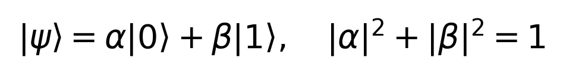
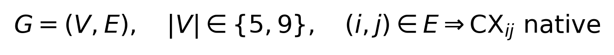
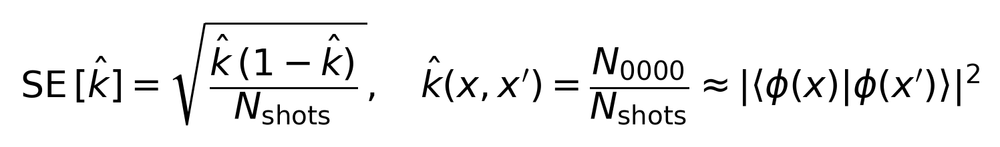
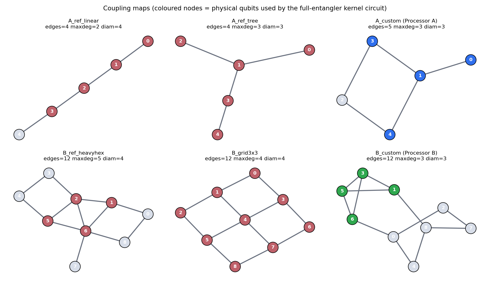
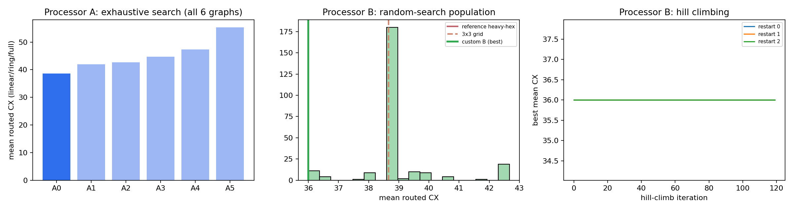
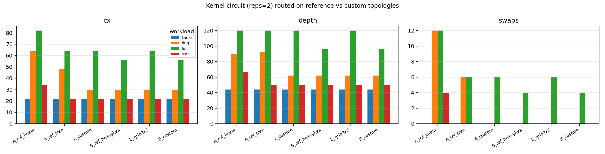
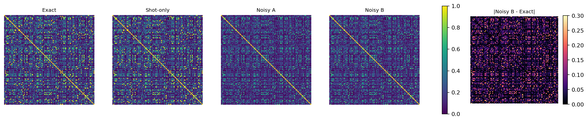
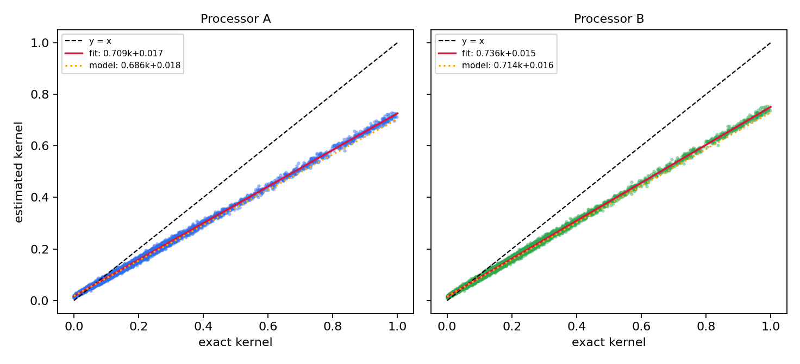
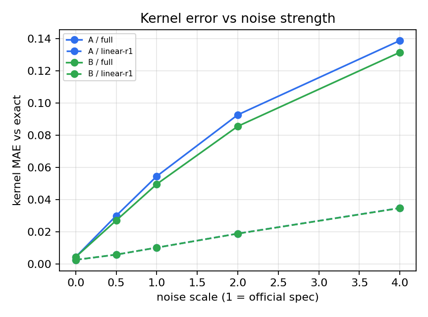
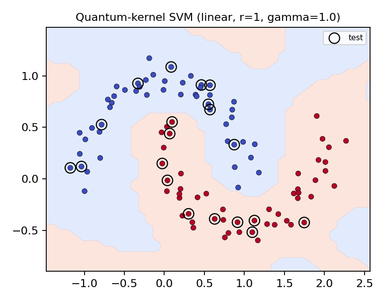

# Quantum Kernel Estimator & QSVM on Two Co-Designed Quantum-Processor Architectures

### Qiskit Fall Fest 2026 · Phase 1 (Online) · Problem Statement **PS-Q2 – Quantum Kernel Estimator & Support Vector Machine (QSVM)** · Track 4: Quantum Machine Learning

> **Central question of the challenge:** *How does the processor architecture change the way the same quantum solution executes?*
> This repository builds **one** quantum-kernel classifier and benchmarks the **identical** solution on **Processor A** (5 qubits) and **Processor B** (9 qubits). Both coupling graphs were **designed by us through a systematic search** (Challenge Step 1), and the differences between them are explained with measured evidence: routed depth, CX count, SWAP count, kernel error, kernel alignment and classification accuracy.

| | |
|---|---|
| **Team** | The Resonancers |
| **Members** | N. Swetha, G. Anuhya, V. Madhulika, A. Likhith Sai, A. Yamini, N. Sushma |
| **Selected track and PS code** | Quantum Machine Learning – **PS-Q2** (Quantum Kernel Estimator & SVM) |
| **Dataset** | `sklearn.datasets.make_moons(n_samples=100, noise=0.1, random_state=42)` → `data/raw/moons_raw.csv` |
| **Repository** |https://github.com/swethanissankara-boop/Qiskit-Fall-2026|
| **Scope** | Phase 1 only: Processor A and Processor B  |

---

## Table of contents
1. [Highlights](#1-highlights)
2. [Problem statement and specification sheet](#2-problem-statement-and-specification-sheet)
3. [Requirement-to-implementation map](#3-requirement-to-implementation-map)
4. [Method](#4-method)
5. [Challenge Step 1 – designing Processor A and Processor B](#5-challenge-step-1--designing-processor-a-and-processor-b)
6. [Controlled A/B experiment design](#6-controlled-ab-experiment-design)
7. [Metrics recorded](#7-metrics-recorded)
8. [Key results](#8-key-results)
9. [Interpretation – answering "what did the architecture change?"](#9-interpretation--answering-what-did-the-architecture-change)
10. [Where to find the analysis and evidence](#10-where-to-find-the-analysis-and-evidence)
11. [Repository structure](#11-repository-structure)
12. [Setup and execution](#12-setup-and-execution)
13. [Reproducibility](#13-reproducibility)
14. [Assumptions and limitations](#14-assumptions-and-limitations-stated-openly)
15. [Mapping to the judging rubric](#15-mapping-to-the-judging-rubric)
16. [Submission checklist](#16-submission-checklist)
17. [AI / LLM assistance disclosure](#17-ai--llm-assistance-disclosure)
18. [References](#references)

---

## 1. Highlights
- **One Problem Statement, one solution, two architectures.** The same logical circuit, data split, SVM regularisation `C`, shot count (4096), simulator seed and transpiler settings (optimisation level 1, seed 42) are used on both processors; **only the coupling graph changes**.
- **Coupling maps**
  - Processor A: *Exhaustive* search over all 6 connected 5-node graphs (≤ 5 edges, max degree 3).
  - Processor B: 250 random graphs + 3 hill-climbing restarts over 12-edge, max-degree-3 graphs (255 evaluated).
  - A *held-out workload* (`star` entangler, never used in the search) checks that the designs do not over-fit.
  - During the search we found that the guide's reference 9-qubit graph needs a **degree-5 hub**, which is unrealistic for fixed-frequency hardware, so our Processor B enforces **max degree 3**.
- **Algorithm ↔ architecture ablation.** 4 feature-map entangler patterns (linear / ring / full / star) × 6 topologies (our two designs + four baselines) → depth, CX and SWAP table.
- **Cost-aware model selection with a stress workload.** Hyper-parameters are chosen by train-only cross-validation; ties go to the cheapest circuit. Because the cheapest map fits both processors perfectly, we add a deliberately dense **stress workload** (full K4 entangler) where connectivity must matter, and report **both**.
- **Error-source ladder.** Exact statevector kernel → shot-noise-only → noisy Processor A → noisy Processor B → reference-topology baselines.
- **A predictive noise law.** Global depolarising noise contracts the kernel as `K_noisy ≈ a·K + b` with `a ≈ F_gates·(1−p_readout)⁴`. Measured slopes agree with the gate-count model to within ≈ 0.02–0.03, so CX count is a *quantitative* predictor of kernel error.
- **Noise-scaling sweep** (0×–4× the specified noise) and a **Bell-pair sanity check** that proves both processors see identical noise.
- **Honest statistics.** With only 20 test points, every accuracy is reported with a 95 % Wilson interval, and we state clearly that accuracy saturates at 100 % and cannot rank the processors – kernel-level metrics do.
- **Fully reproducible.** Seed 42 everywhere, pinned `requirements.txt`, cached Gram matrices, deterministic re-runs (verified by executing the notebook twice with identical numbers).
- **AI assistance documented** in `docs/ai/` (ADRs, issues, patterns, plan evolution, post-mortem, prompts).

---

## 2. Problem statement and specification sheet

| Item | Value |
|---|---|
| PS code / name | **PS-Q2** – Quantum Kernel Estimator & Support Vector Machine (QSVM) |
| Track | Track 4 – Quantum Machine Learning |
| Task | Construct a quantum kernel matrix using fidelity state overlap `|⟨φ(x)|φ(x′)⟩|²` on a **4-qubit register**. Train a classical SVM with the quantum kernel. **Compare kernel evaluation cost on A vs B.** |
| Instance | `make_moons(n_samples=100, noise=0.1, random_state=42)`; stratified **80 train / 20 test** split (seed 42) |
| Core algorithm | ZZ-style quantum feature map → fidelity kernel (compute–uncompute circuit) → `SVC(kernel="precomputed")` |
| Primary metric | Test accuracy with 95 % Wilson interval; also repeated-CV accuracy |
| Kernel-quality metrics | Kernel MAE / RMSE / max error / relative Frobenius error vs the exact kernel, kernel–target alignment (KTA), affine contraction `(a, b)`, off-diagonal spread, effective rank, minimum eigenvalue |
| Reference / classical baseline | Exact statevector kernel; shot-noise-only kernel; classical RBF-SVM on the same scaled features |
| Processor A | 5 physical qubits, basis `{rz, sx, x, cx}`, **custom coupling graph (designed by us)** |
| Processor B | 9 physical qubits, basis `{rz, sx, x, cx}`, **custom coupling graph (designed by us)** |
| Synthetic noise (identical on A and B) | 1-qubit depolarising **0.1 %** (p = 0.001) · CX depolarising **0.5 %** (p = 0.005) · readout error **1.0 %** (p = 0.01) |
| Transpilation | Optimisation level **1**, seed **42**, shots **4096** |
| Architecture metrics | Depth, CX depth, CX count, SWAP count, 1-qubit gate count, active physical qubits, chosen layout, estimated gate fidelity, circuits and shots executed, executed-CX volume, simulation time |

---

## 3. Requirement-to-implementation map

| Master Guide requirement | Where / how it is met |
|---|---|
| Exactly one PS, documented in README | PS-Q2 only (this file) |
| `make_moons(n_samples=100, noise=0.1, random_state=42)` | `src/problem.py::make_dataset` → `data/raw/moons_raw.csv` |
| 4-qubit register, fidelity kernel `|⟨φ(x)\|φ(x′)⟩|²` | `src/problem.py::feature_map`, `kernel_circuit` (compute–uncompute, probability of `0000`) |
| Classical SVM trained on the quantum kernel | `SVC(kernel="precomputed")` – `src/problem.py::svm_accuracy` |
| Compare kernel evaluation cost on A vs B | `results/tables/kernel_evaluation_cost.csv`, §8.4 |
| Processor A = 5 qubits, Processor B = 9 qubits | `processors/processor_A.json`, `processors/processor_B.json` |
| Basis gates `{rz, sx, x, cx}` | `src/routing.py::BASIS_GATES` (also stored in the JSON files) |
| Optimisation level 1, seed 42, 4096 shots | `src/routing.py`, `src/problem.py` |
| Identical synthetic noise on A and B (0.1 % / 0.5 % / 1 %) | `src/processors.py::build_noise_model` |
| Coupling maps built from scratch, justified | §5, `processors/*.json` (`design_rationale` field), `results/tables/design_search_processor_*.csv` |
| Quantitative comparison table: depth, CX, SWAP, accuracy | §8, `results/tables/final_comparison_table.csv` |
| Required repository structure (+ `docs/ai/`) | §11 |
| Phase 1 scope: no Processor C / D | ✔ nothing implemented for C or D |

---

## 4. Method

```
make_moons(100, noise=0.1, seed=42)
      │  stratified split (80 train / 20 test, seed 42)
      ▼
MinMaxScaler → [0, 1]                       (fitted on the TRAINING split only)
      │
      ▼
Polynomial lift  2 → 4 features:   f(x) = [ x0 ,  x1 ,  x0·x1 ,  x0² − x1² ]   (one lifted feature per qubit)
      │  rotation angle  aᵢ = γ · fᵢ(x)           (γ = bandwidth hyper-parameter)
      ▼
ZZ-style feature map U(x) on 4 qubits, `reps` repetitions of
      H  →  P(2aᵢ)  →  for each entangler pair (i,j):  CX · P(2(π−aᵢ)(π−aⱼ)) · CX
      entangler graph ∈ { linear, ring, full }   (+ star: held-out test workload only)
      │
      ▼
Fidelity-kernel circuit (compute–uncompute):  U(x) followed by U(y)†,  measure all 4 qubits
      k(x, y) = P(0000) = |⟨φ(y)|φ(x)⟩|²
      │
      ▼
Parametrised circuit transpiled ONCE per processor (coupling map + {rz,sx,x,cx} + level 1 + seed 42),
parameters bound per data pair
      │
      ▼
Aer execution, 4096 shots:   shot-only (no hardware noise)   |   noisy (official synthetic noise model)
      │
      ▼
Gram matrix (100 × 100, upper triangle simulated, diagonal := 1)
      │
      ▼
SVC(kernel="precomputed", C fixed by train-only CV on the exact kernel)
      │
      ▼
Classification metrics + kernel-quality metrics + circuit/architecture metrics → A vs B comparison
```

### 4.1 Encoding: why a polynomial lift?
`make_moons` has only **2 raw features**, but the problem statement requires a **4-qubit** register. We therefore lift each (scaled) point to four features `[x0, x1, x0·x1, x0² − x1²]` and encode one per qubit. This keeps the register at exactly 4 qubits, adds non-linear feature interactions, and costs no extra circuit width.

### 4.2 Feature map and kernel
Each repetition applies Hadamards, single-qubit phase rotations `P(2aᵢ)` and, for every pair in the chosen entangler graph, the two-qubit interaction `CX · P(2(π−aᵢ)(π−aⱼ)) · CX` (the ZZFeatureMap construction). The entangler graph is the knob that couples the *algorithm* to the *hardware coupling map*:

| Entangler | Pairs | Logical CX at 2 reps (kernel circuit) |
|---|---|---|
| `linear` | (0,1) (1,2) (2,3) | 24 |
| `ring` | linear + (3,0) | 32 |
| `full` | all 6 pairs (K4) | 48 |
| `star` *(held-out)* | (0,1) (0,2) (0,3) | 24 |

Key equations (rendered in `assets/qff_phase1_latex_images/`):





### 4.3 Cost-aware model selection (no test leakage)
- Grid: 3 entanglers × 2 repetitions {1, 2} × 4 bandwidths γ {0.5, 1, 2, 3} × 4 values of C {0.1, 1, 10, 100} = **96 configurations**.
- Score: repeated stratified 5-fold CV (3 repeats) on the **80 training rows only**, using the **exact** (noise-free) kernel.
- **Cost-aware rule:** among all configurations within 1 % of the best CV accuracy, choose the one with the **fewest logical CX gates** (then fewer repetitions, then smaller `C`).
- The test split is never used for any selection.

| Workload | Feature map | γ | C | Train-CV accuracy | Logical CX |
|---|---|---|---|---|---|
| **MAIN** (cost-aware choice) | `linear`, 1 rep | 1.0 | 1 | 0.9917 | 12 |
| **STRESS** (densest entangler) | `full`, 2 reps | 0.5 | 1 | 1.0000 | 48 |

Why two workloads? The cheapest feature map (`linear`, 1 rep) embeds directly into the coupling graphs of **both** processors with zero SWAPs, so A and B tie exactly. That is an honest result, but it hides architectural differences. The STRESS workload uses the full K4 entangler: neither coupling graph contains a 4-clique, so routing is unavoidable and the architecture effect becomes measurable.

### 4.4 Design choices (full rationale in `docs/ai/adrs.md`)
- **Parametrised, route-once circuits** – the kernel circuit is transpiled once per processor and parameters are bound per pair, so every kernel entry uses an identical compiled circuit (as on real hardware) and the transpiler cannot exploit per-pair angle coincidences.
- **Kernel diagonal set to 1**, upper triangle simulated and mirrored (standard practice; the diagonal is analytically 1).
- **`rz` is treated as a virtual (frame-change) gate** and carries no noise; `sx` and `x` carry the 1-qubit depolarising error. A pessimistic variant (`noisy_rz=True`) is available in `build_noise_model`.
- **SWAP counting**: SWAPs are decomposed into 3 CX by the basis translator, so the SWAP count is read from a second compile with the same seed that keeps `swap` in the basis.

---

## 5. Challenge Step 1 – designing Processor A and Processor B

The Master Guide states that the coupling maps shown are **reference architectures only**, that participants must build both processors **from scratch**, and that *"your architecture is part of your solution."* We therefore treated the coupling graph as an optimisation variable.

### 5.1 Search procedure
| | Processor A (5 qubits) | Processor B (9 qubits) |
|---|---|---|
| Search space | **All** connected 5-node graphs with ≤ 5 edges and max degree ≤ 3 (networkx graph atlas) → **6 candidates** | Connected 9-node graphs with ≤ 12 edges (same budget as the reference) and max degree ≤ 3 |
| Method | Exhaustive enumeration | 250 random graphs + hill-climbing (3 restarts × 120 edge-rewire moves, seed 42) → **255 graphs evaluated** |
| Objective (lexicographic) | mean routed CX over the workload family {linear, ring, full} at 2 reps → mean depth → average shortest path → #edges → max degree | same |
| Guard against over-fitting | Held-out `star` workload (never used in the search) | same |
| Search time | ≈ 25 s (both searches, one CPU) | |

**Hardware-realism constraint (max degree 3).** Fixed-frequency transmon devices limit the number of couplers per qubit (crosstalk and frequency collisions). The guide's reference 9-qubit graph has a **degree-5 hub on qubit 6** and the 3×3 grid has degree 4, so neither is a feasible search seed; both are only used as **baselines**. (A first version of our search accidentally started from the reference graph and inherited its degree-5 hub – this bug and its fix are recorded in `docs/ai/issues.md`, I-02.)

### 5.2 The designed graphs

| | **Processor A (custom)** | **Processor B (custom)** |
|---|---|---|
| Qubits / edges | 5 / 5 | 9 / 12 |
| Coupling map | `0–1, 1–3, 1–4, 2–3, 2–4` | `0–2, 0–4, 0–6, 1–3, 1–5, 1–8, 2–7, 3–5, 3–6, 4–8, 5–6, 7–8` |
| Structure | A **4-cycle** (1–3–2–4) plus a **pendant** qubit 0 attached to qubit 1 | Degree-3 graph with two triangles and one 4-cycle |
| Degree sequence | [3, 2, 2, 2, 1] | [3, 3, 3, 3, 3, 3, 2, 2, 2] |
| Max degree | 3 | 3 |
| Diameter / avg. shortest path | 3 / 1.60 | 3 / 1.94 |
| Algebraic connectivity | 0.830 | 0.631 |
| Triangles / 4-cycles | 0 / 1 | 2 / 1 |
| Basis gates | `rz, sx, x, cx` | `rz, sx, x, cx` |
| Definition file | `processors/processor_A.json` | `processors/processor_B.json` |

**Design rationale.**
- **Processor A:** the 4-cycle hosts the ring-entangled 4-qubit feature map with **zero SWAPs**; the pendant qubit keeps max degree at 3 and gives the router a spare qubit. This is the best of all 6 candidate graphs for the workload family.
- **Processor B:** the search reaches the **CX floor of the workload family** (36.0 mean CX, identical to the reference heavy-hex-inspired graph) while respecting max degree 3. Honest summary: **B matches the reference in routing quality, and improves on it in physical realism** (degree 3 instead of 5). The 3×3 grid is actually *worse* (64 CX on the full entangler vs 56).

Coupling-map diagrams (coloured nodes = physical qubits used by the full-entangler kernel circuit):



Design-space search (A: all 6 graphs · B: random-search population and hill climbing):



### 5.3 Evidence: reference vs custom topologies (kernel circuit, 2 repetitions)
Each cell shows **routed CX / depth / SWAPs** after transpilation (level 1, seed 42, basis `{rz,sx,x,cx}`).

| Topology | max deg. | linear | ring | full | star *(held-out)* |
|---|---|---|---|---|---|
| A – reference linear chain | 2 | 22 / 44 / 0 | 64 / 90 / 12 | 82 / 120 / 12 | 34 / 67 / 4 |
| A – reference tree | 3 | 22 / 44 / 0 | 48 / 92 / 6 | 64 / 120 / 6 | 22 / 50 / 0 |
| **A – custom (Processor A)** | 3 | 22 / 44 / 0 | **30 / 62 / 0** | 64 / 120 / 6 | 22 / 50 / 0 |
| B – reference heavy-hex-inspired | 5 | 22 / 44 / 0 | 30 / 62 / 0 | 56 / 96 / 4 | 22 / 50 / 0 |
| B – 3×3 grid | 4 | 22 / 44 / 0 | 30 / 62 / 0 | 64 / 120 / 6 | 22 / 50 / 0 |
| **B – custom (Processor B)** | 3 | 22 / 44 / 0 | 30 / 62 / 0 | **56 / 96 / 4** | 22 / 50 / 0 |

Reading the table:
- Ring entangler on **Processor A**: **30 CX vs 64 CX** on the reference chain (**−53 %**), 0 SWAPs vs 12.
- Full entangler on **Processor A**: 64 CX vs 82 on the chain (**−22 %**), 6 SWAPs vs 12 (**−50 %**).
- Held-out `star` workload: custom A (22 CX) equals the best reference and beats the chain (34 CX) → **no sign of over-fitting**.
- Linear entangler: every topology ties at 22 CX – a linear pattern embeds trivially in any connected graph.



---

## 6. Controlled A/B experiment design

| Rule | How it is enforced |
|---|---|
| One PS | Only PS-Q2 is implemented. |
| Controlled comparison | Same dataset split, scaler, feature lift, feature map, kernel circuit, γ, `C`, shots (4096), simulator seed (42) and transpiler settings (level 1, seed 42, basis `{rz,sx,x,cx}`) on A and B. |
| Identical noise | One `build_noise_model()` is used for both processors, so any difference in the noisy results comes from **compiled circuit cost (routing)**, not from different error rates. Verified by the Bell-pair check (§8.6). |
| Evidence first | Every number in this README is copied from `results/tables/` produced by `main.ipynb`. |

Execution scenarios per workload:

| Scenario | Meaning |
|---|---|
| **Exact** | Noise-free, shot-free statevector kernel (the reference). |
| **Shot-noise only** | Noise-free sampling with 4096 shots – isolates finite-sampling error. |
| **Noisy A / Noisy B** | Compiled circuit on each processor with the official synthetic noise model. |
| **Reference baselines (STRESS only)** | Noisy runs on the guide's reference linear chain and reference heavy-hex graph, to show the benefit of our designs. |

---

## 7. Metrics recorded

| Group | Metrics |
|---|---|
| **Problem performance** | Test accuracy (n = 20) with 95 % Wilson interval · train-CV accuracy · repeated-CV accuracy over all 100 points (informational) |
| **Kernel quality** | Kernel MAE · RMSE · max absolute error · relative Frobenius error vs exact kernel · kernel–target alignment (KTA, centred) · affine fit `K_noisy ≈ a·K + b` · off-diagonal mean/std (concentration) · effective rank · minimum eigenvalue |
| **Circuit / architecture** | Depth · CX depth · CX count · 1-qubit gate count (`rz`, `sx`, `x`) · **SWAP count** · active physical qubits · initial layout (physical qubits chosen) · estimated gate fidelity `(1−p₁)^{#sx+#x}(1−p₂)^{#cx}` · predicted contraction slope |
| **Kernel-evaluation cost** | Circuits per Gram matrix · circuits needed for train×train + test×train · shots per circuit · total shots · **executed-CX volume** (circuits × shots × CX) · simulation time |
| **Reference models** | Exact-kernel SVM · shot-only SVM · classical RBF-SVM on the same scaled features (grid-searched on train) |
| **Extra studies** | Noise-scaling sweep (0×, 0.5×, 1×, 2×, 4×) · Bell-pair noise-model sanity check · decision-region plot |

---

## 8. Key results
All values: seed 42, 4096 shots, 4950 circuits per full Gram matrix (100 × 100 upper triangle). Source files are in `results/tables/`.

### 8.1 Designed processors at a glance
| | Processor A | Processor B |
|---|---|---|
| Qubits / edges / max degree | 5 / 5 / 3 | 9 / 12 / 3 |
| Active physical qubits in every run | 4 | 4 |

### 8.2 Classification and kernel quality
| Workload | Backend | CX | Depth | SWAP | Kernel MAE | Rel. Frobenius err. | KTA (train) | Test acc. [95 % CI] |
|---|---|---|---|---|---|---|---|---|
| **MAIN** `linear`-r1 | Exact kernel | – | – | – | 0 | 0 | 0.3722 | 1.00 [0.84, 1.00] |
| | Shot-noise only | – | – | – | 0.0025 | 0.014 | 0.3721 | 1.00 |
| | **Noisy A** | 10 | 24 | 0 | 0.0098 | 0.072 | 0.3688 | 1.00 |
| | **Noisy B** | 10 | 24 | 0 | 0.0098 | 0.072 | 0.3688 | 1.00 |
| **STRESS** `full`-r2 | Exact kernel | – | – | – | 0 | 0 | 0.3578 | 1.00 |
| | Shot-noise only | – | – | – | 0.0042 | 0.017 | 0.3579 | 1.00 |
| | **Noisy A (custom)** | 64 | 120 | 6 | 0.0533 | 0.244 | 0.3460 | 1.00 |
| | **Noisy B (custom)** | **56** | **96** | **4** | **0.0484** | **0.222** | **0.3478** | 1.00 |
| | Noisy A – reference linear chain | 82 | 120 | 12 | 0.0633 | 0.290 | 0.3414 | 1.00 |
| | Noisy B – reference heavy-hex | 56 | 96 | 4 | 0.0485 | 0.222 | 0.3477 | 1.00 |
| **Classical** | RBF-SVM (same scaled features) | | | | | | | 1.00 (CV 0.992) |

### 8.3 Head-to-head on the STRESS workload
| Comparison | CX | Depth | SWAPs | Kernel MAE |
|---|---|---|---|---|
| **B vs A (both custom)** | −12.5 % (56 vs 64) | −20 % (96 vs 120) | −33 % (4 vs 6) | −9 % (0.0484 vs 0.0533) |
| **Custom A vs reference linear chain** | −22 % (64 vs 82) | same (120) | −50 % (6 vs 12) | −16 % (0.0533 vs 0.0633) |
| **Custom B vs reference heavy-hex** | equal (56) | equal (96) | equal (4) | equal (0.0484 vs 0.0485) |

### 8.4 Kernel-evaluation cost on A vs B (the quantity PS-Q2 asks to compare)
| Workload | Processor | Layout (physical qubits) | Depth | CX depth | CX | SWAP | Executed CX per Gram | Est. gate fidelity | Sim. time |
|---|---|---|---|---|---|---|---|---|---|
| MAIN | A | [2, 3, 1, 0] | 24 | 10 | 10 | 0 | 203 M | 0.944 | 45 s |
| MAIN | B | [7, 2, 0, 4] | 24 | 10 | 10 | 0 | 203 M | 0.944 | 45 s |
| STRESS | A | [1, 4, 3, 0] | 120 | 64 | 64 | 6 | 1298 M | 0.714 | 62 s |
| STRESS | B | [3, 5, 6, 1] | 96 | 48 | 56 | 4 | 1135 M | 0.743 | 63 s |
| STRESS | A – ref. chain | [1, 2, 0, 3] | 120 | 68 | 82 | 12 | 1663 M | 0.652 | 64 s |

- A full Gram matrix needs **4950 circuits × 4096 shots = 20.3 M shots**.
- Only **4760 circuits** are needed if just the train×train (3160) and test×train (1600) entries are required.
- Simulation time is a property of the simulator, not of hardware; it is reported only for reference.

### 8.5 The noise acts as a predictable contraction of the kernel
Global depolarising noise predicts `K_noisy ≈ a·K + b` with `a ≈ (1−p₁)^{#sx+#x} · (1−p₂)^{#cx} · (1−p_readout)⁴` and `b ≈ (1−F_gates)/16`.

| Run | Fitted slope a | Model-predicted a | Intercept b | Off-diag. std (exact 0.218) | Effective rank (exact 14.2) |
|---|---|---|---|---|---|
| MAIN – Noisy A / B | 0.917 / 0.917 | 0.906 | 0.004 | – | – |
| STRESS – Noisy A | 0.709 | 0.686 | 0.0169 | 0.155 | 34.3 |
| STRESS – Noisy B | 0.736 | 0.714 | 0.0154 | 0.160 | 32.2 |
| STRESS – A, reference chain | 0.653 | 0.627 | 0.0203 | 0.142 | 38.9 |

Consequences:
1. **CX count is a quantitative predictor of kernel error**, not just a proxy – fitted and predicted slopes agree to within ≈ 0.02–0.03.
2. Noise pushes the kernel toward the identity (diagonal stays 1, off-diagonals shrink): the **effective rank rises from 14 to 32–39** and kernel–target alignment falls monotonically with routed CX: 0.3578 (exact) → 0.3478 (B) → 0.3460 (A) → 0.3414 (chain).




### 8.6 Noise-model sanity check (Bell pair on every coupling edge)
Preparing a Bell pair on every edge of both processors gives population fidelity **F = 0.9775** and **⟨Z·Z⟩ = 0.9551** on average, versus an analytic prediction of ⟨ZZ⟩ ≈ 0.954 – identical on A and B. This confirms that the two processors see **exactly the same noise**, so every difference in §8.2–8.4 is caused by routing.

### 8.7 Noise-scaling sweep (300 random pairs, whole noise model scaled)
| Workload / processor | 0× (shot only) | 0.5× | 1× | 2× | 4× |
|---|---|---|---|---|---|
| MAIN – A | 0.0026 | 0.0058 | 0.0102 | 0.0189 | 0.0348 |
| MAIN – B | 0.0026 | 0.0058 | 0.0102 | 0.0189 | 0.0347 |
| STRESS – A | 0.0044 | 0.0300 | 0.0545 | 0.0927 | 0.1388 |
| STRESS – B | 0.0044 | 0.0270 | 0.0496 | 0.0855 | 0.1315 |

(Kernel MAE vs exact kernel.) Error grows roughly linearly with noise strength; B is 5–10 % lower than A at every non-zero scale on the stress workload, and the two processors are indistinguishable on the main workload, exactly as the identical routed circuits predict.



### 8.8 Decision regions of the exact quantum-kernel SVM


---

## 9. Interpretation – answering "what did the architecture change?"

1. **What changed in execution?** On the MAIN workload, nothing – both processors compile to 10 CX, depth 24, 0 SWAPs. On the STRESS workload, Processor B needs **8 fewer CX, 24 fewer layers of depth and 2 fewer SWAPs** than Processor A.
2. **Which architectural property explains it?** Neither graph contains a 4-clique, so the full K4 entangler cannot run natively on either. Processor A is a small graph (5 edges, 4-cycle + pendant): its 4-cycle covers four of the six K4 pairs natively and the two diagonal pairs need routing. Processor B's router found the physical qubits 1, 3, 5, 6, whose edges (1–3, 1–5, 3–5, 3–6, 5–6) form a **diamond (K4 minus one edge)**, so five of the six K4 pairs are native and fewer SWAPs are needed. The advantage comes from **richer local connectivity, not from having more qubits** – only 4 physical qubits are active in every run.
3. **How much extra routing?** STRESS: 6 SWAPs on A, 4 on B (the guide's reference chain needs 12).
4. **How many extra operations?** The logical STRESS kernel circuit has 48 CX. After routing: **64 on A (+16)** and **56 on B (+8)**. On the MAIN workload the routed circuit has *fewer* CX (10) than the logical one (12) because the optimiser cancels CX pairs at the `U(x)` / `U(y)†` junction.
5. **Did the problem-level metric change?** Test accuracy stays at **100 %** on every backend, so accuracy does **not** discriminate A from B. Kernel MAE, relative Frobenius error and kernel–target alignment do, and they order consistently with routed CX count (B < A < reference chain).
6. **Gate-set / noise confounders?** None by construction: same basis gates, same noise numbers, same seeds, same transpiler settings. The Bell-pair check verifies identical per-gate noise.
7. **What remains uncertain?** (i) With 20 test points the accuracy CI is [0.84, 1.00] even at 100 %. (ii) Level-1 Sabre routing is a heuristic and its SWAP counts can change with the Qiskit version or seed. (iii) Results from one pair of finite graphs do not establish a universal advantage of either architecture. (iv) The noise is simulated, not measured on hardware.

**Design recommendations that follow from the evidence**
- *Match the entangler graph to the coupling graph.* A ring feature map on a 4-cycle costs 30 CX; on a chain it costs 64.
- *Prefer the cheaper entangler when accuracy allows.* Choosing the `linear` map removed the processor dependence entirely at no accuracy cost.
- *Extra qubits only help if they add useful local connectivity* (triangles, short cycles), not merely more nodes.
- *Minimise routed CX first, then depth* – kernel error is approximately linear in routed CX at fixed noise.

---

## 10. Where to find the analysis and evidence
- **`report.md`** – method, processor design, kernel-evaluation cost, kernel quality, classification, trade-offs, limitations.
- **`main.ipynb`** – executable end-to-end experiment (28 cells, with all intermediate outputs and embedded figures).
- **`docs/ai/`** – decision records, issue log, reusable patterns, plan evolution, post-mortem, prompt log.
- **Interpretation principles:** connectivity effects are separated from gate-set/noise effects; accuracy differences within the 95 % interval are not interpreted; a result from one pair of graphs is **not** claimed as a universal architectural advantage.

Result tables (`results/tables/`):

| File | Content |
|---|---|
| `design_search_processor_A.csv`, `design_search_processor_B.csv` | Leaderboards of all evaluated candidate graphs |
| `topology_benchmark_all_workloads.csv` | CX / depth / SWAP for 6 topologies × 4 entangler workloads |
| `model_selection_cv.csv` | All 96 hyper-parameter configurations with CV scores |
| `summary_main.csv`, `summary_stress.csv` | Full per-backend metrics (accuracy, CI, kernel error, KTA, spectrum, affine fit, circuit metrics) |
| `kernel_evaluation_cost.csv` | Circuits, shots, executed-CX volume, layout, estimated fidelity |
| `noise_scaling_sweep.csv` | Kernel MAE vs noise scale |
| `noise_sanity_bell.csv` | Bell-pair fidelity and ⟨ZZ⟩ on every edge |
| `final_comparison_table.csv`, `summary.json` | Consolidated comparison and configuration/version record |

Figures (`results/figures/`):

| File | Content |
|---|---|
| `01_dataset.png` | make_moons dataset with train/test markers |
| `02_design_space_search.png` | Processor A/B design search |
| `03_topology_benchmark.png` | CX / depth / SWAP: reference vs custom topologies |
| `04_kernel_heatmaps_stress.png`, `04b_kernel_heatmaps_main.png` | Exact, shot-only, noisy A and B kernels and error maps |
| `05_affine_contraction_{main,stress}.png` | Noisy vs exact kernel entries with fitted and predicted lines |
| `06_test_accuracy.png` | Test accuracy with Wilson intervals |
| `07_noise_sweep.png` | Kernel error vs noise scale |
| `08_decision_regions_exact_kernel.png` | Quantum-kernel SVM decision regions |
| `09_coupling_maps.png` | Reference and custom coupling graphs (used qubits highlighted) |

---

## 11. Repository structure

```
project/
├── README.md                    ← this file
├── main.ipynb                   ← reproducible end-to-end experiment (executed, outputs included)
├── requirements.txt             ← pinned environment
├── report.md                    ← architectural analysis, trade-offs, limitations
├── data/
│   ├── raw/
│   │   └── moons_raw.csv        ← generated make_moons data + split labels
│   └── processed/
│       ├── moons_scaled.npz     ← train-fitted MinMax-scaled features, labels, split indices
│       ├── kernels_main.npz     ← cached Gram matrices (MAIN workload)
│       └── kernels_stress.npz   ← cached Gram matrices (STRESS workload)
├── processors/
│   ├── processor_A.json         ← Processor A: coupling map, basis, noise, transpile config, rationale, stats
│   └── processor_B.json         ← Processor B
├── src/
│   ├── __init__.py
│   ├── problem.py               ← data, polynomial lift, feature map, kernel circuit, exact kernel, SVM, model selection
│   ├── processors.py            ← noise model, reference graphs, topology search (A exhaustive, B random+hill-climb), JSON I/O
│   ├── routing.py               ← transpilation, SWAP counting, kernel execution on Aer
│   ├── metrics.py               ← circuit metrics, kernel-quality metrics, Wilson interval
│   └── visualization.py         ← coupling-graph and result plots
├── results/
│   ├── tables/                  ← CSV/JSON result tables
│   └── figures/                 ← all figures
├── assets/
│   └── qff_phase1_latex_images/ ← eq_qubit_state, eq_bell_state, eq_graph, eq_bell_fidelity, eq_zz_expectation, eq_standard_error (.png)
└── docs/
    └── ai/
        ├── adrs.md  issues.md  patterns.md
        └── plan-evolution.md  postmortem.md  prompts.md
```

(`src/__init__.py` is the standard Python package file; the guide's `_init _.py` is a typesetting artefact.)

---

## 12. Setup and execution

**Requirements:** Python 3.12 (tested); pinned packages in `requirements.txt`: `qiskit==2.5.2`, `qiskit-aer==0.17.2`, `numpy`, `scipy`, `scikit-learn`, `networkx`, `pandas`, `matplotlib`, plus notebook tooling (`ipython`, `ipykernel`, `nbformat`, `nbconvert`, `jupyter_client`).

### Local machine
```bash
python -m venv .venv
source .venv/bin/activate            # Windows PowerShell: .venv\Scripts\Activate.ps1
pip install -r requirements.txt

jupyter nbconvert --to notebook --execute --inplace main.ipynb --ExecutePreprocessor.timeout=-1
```
(or `jupyter notebook` → open `main.ipynb` → *Run → Run All Cells*). Outputs are written into `results/`, `processors/` and `data/processed/`.

### Google Colab
1. Upload the project zip (`from google.colab import files; files.upload()`), unzip, and `cd` into the folder.
2. `pip install -r requirements.txt`
3. Open and run `main.ipynb`.
4. Download `results/`, `processors/` and the executed notebook before closing the session.

### Run time
| Mode | Time (1 CPU) |
|---|---|
| Default (cached Gram matrices in `data/processed/`) | ≈ 3–4 min (topology searches ≈ 25 s, noise sweep ≈ 1 min, analysis) |
| `RECOMPUTE = True` (first code cell – re-simulate every kernel) | ≈ 10 min |

### Configuration
Core constants live in `src/problem.py` (seed, samples, qubits, shots, split size) and `src/processors.py` (noise parameters `NOISE_PARAMS`, reference graphs, search workload family). Per-processor settings (coupling map, basis gates, noise, transpile options) are stored in `processors/*.json`.

---

## 13. Reproducibility
- Seed **42** controls the dataset, the split, cross-validation, the topology searches, Aer sampling and the transpiler.
- The notebook was executed twice from the cached state and produced **identical numbers**.
- The parametrised kernel circuit is transpiled **once per processor**, so every kernel entry uses the same compiled circuit.
- Versions of Qiskit / Aer are recorded in `results/tables/summary.json`; all dependencies are pinned in `requirements.txt`.
- All tables are machine-readable (CSV/JSON); all figures are regenerated by the notebook.
- Processor JSON rationales are **generated from computed statistics**, not typed by hand.

---

## 14. Assumptions and limitations (stated openly)
1. **Noise parameters** follow the Master Guide: 1-qubit depolarising 0.1 %, CX depolarising 0.5 %, readout error 1 % (symmetric), applied **identically** to A and B. If the official Challenge Kit specifies different values, change `NOISE_PARAMS` in `src/processors.py` and re-run (`RECOMPUTE = True`) – no other change is needed.
2. **`rz` is noise-free** (virtual frame-change gate); `sx` and `x` carry the 1-qubit error. `build_noise_model(noisy_rz=True)` gives a pessimistic variant.
3. **Kernel diagonal fixed to 1** (analytically exact); this makes the noise-induced contraction visible as diagonal dominance.
4. **Simulation only** (Qiskit Aer). No hardware results; no quantum-advantage claim.
5. **Statistical power.** The test split has only 20 points, so accuracy cannot discriminate the processors; we rely on kernel-level metrics and say so explicitly. The "all-data CV" column is informational only (hyper-parameters were fixed from training data).
6. **Topology search is workload-specific.** The designs are tuned on the entangler family {linear, ring, full}; the held-out `star` workload shows no over-fitting, but other workloads might favour other graphs.
7. **Routing is heuristic.** Level-1 Sabre routing is seed- and version-dependent (hence the pinned versions and seed).
8. **Processor B's gain over the reference heavy-hex graph is realism (max degree 3 instead of 5), not fewer CX** – the search plateaus at the same CX floor.
9. **One pair of finite graphs** does not establish a universal advantage of either architecture.

---

## 15. Mapping to the judging rubric

| Criterion | Weight | Where it is addressed |
|---|---|---|
| **Scientific & algorithmic correctness** | 30 pts | Exact statevector kernel as reference; shot-only and noisy runs; classical RBF-SVM baseline; train-only model selection (no leakage); Wilson intervals (§4, §8.2) |
| **Processor A vs B architectural analysis & creativity** | 35 pts | Search-designed coupling graphs with realism constraint and held-out workload (§5); depth / CX / SWAP / kernel-error comparison (§8); predictive noise-contraction law (§8.5); noise sweep (§8.7); candid interpretation (§9) |
| **Reproducibility & code quality** | 20 pts | Pinned `requirements.txt`, seed 42, route-once parametrised design, cached Gram matrices, deterministic re-runs, modular `src/` (§11–13) |
| **Documentation & visualisations** | 15 pts | This README, `report.md`, coupling-map diagrams, kernel heat-maps, topology/benchmark/noise-sweep plots, `docs/ai/` (§10) |

---

## 16. Submission checklist
- [x] Exactly **one** Problem Statement selected and documented (PS-Q2)
- [x] Core solution implemented and verified against the exact classical/quantum reference
- [x] Coupling maps for Processor A (5 q) and Processor B (9 q) creatively defined, justified and transpiled
- [x] Quantitative comparison table generated (depth, CX count, SWAP overhead, accuracy on A vs B)
- [x] Repository follows the required file structure (`main.ipynb`, `requirements.txt`, `processors/`, `results/`, `src/`, `assets/`, `report.md`, `docs/ai/`)
- [x] Phase 1 scope respected: Processor A and B only (no C / D)
- [ ] Public GitHub repository submitted at https://qffsrmap2026.com/learning/hackathon **before Wed, Oct 14, 2026, 23:59 IST**
- [ ] Final check: executed `main.ipynb`, `results/`, `data/processed/` and `report.md` are committed and the repository is **public**

---

## 17. AI / LLM assistance disclosure
An AI assistant (Claude, Anthropic) was used during development for code scaffolding, drafting of documentation and structuring of the analysis. The record of AI involvement – architecture decisions (`adrs.md`), issues and risks (`issues.md`), reusable patterns (`patterns.md`), how the plan changed (`plan-evolution.md`), an honest post-mortem (`postmortem.md`) and the prompts given (`prompts.md`) – is kept in `docs/ai/`. The team has reviewed, executed and takes responsibility for the submitted code, results and conclusions; all numerical results in this repository come from the executed notebook, not from the AI's text.

---

## References
- Qiskit Fall Fest 2026 – Phase 1 Master Guide (Hackathon & Competitions Cell, SRM University-AP)
- Havlíček et al., *Supervised learning with quantum-enhanced feature spaces*, Nature 567, 209 (2019)
- Qiskit and Qiskit Aer documentation – transpilation, `NoiseModel`, `AerSimulator`, `Statevector`
- scikit-learn documentation – `make_moons`, `SVC(kernel="precomputed")`
- NetworkX documentation – graph atlas, graph metrics
